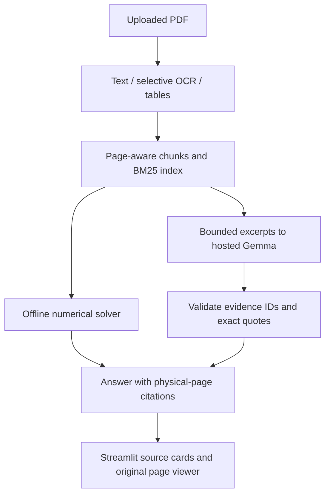
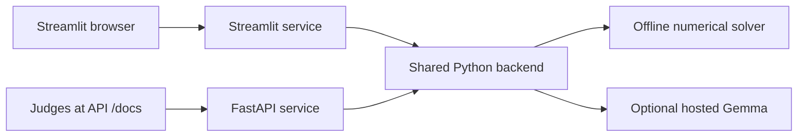

# Report Navigator — Sloths

[Live app](https://sloths-report-navigator.streamlit.app) · [Try the HTTP API in Swagger UI](https://sloths-report-navigator-api.onrender.com/docs) · [swagger.json](https://sloths-report-navigator-api.onrender.com/swagger.json)

Offline question answering over government statistics PDFs, with exact integer
answers, physical-page citations and selective OCR. Streamlit provides the web
interface. V5 adds hosted general document QA for notes and explanatory prose;
the scored numerical pipeline remains offline. No local Gemma model is included.

## Problem understanding

**Challenge: Problem statement 5 — question answering over statistical reports.**

Journalists and officials need exact figures from long reports containing tables,
not plausible explanations. We retrieve evidence, identify the requested entity,
year and measure, and return the supported cell or NOT_FOUND. The scoring report
is unseen, so the system builds its index from the supplied PDF at runtime and
must cope with scanned pages without internet access.

## Approach

Python 3.11, PyMuPDF, local Tesseract and BM25Plus form the scoring pipeline.
Native tables preserve merged headings, row labels and cell coordinates. OCR
runs selectively in a time-bounded child process using a declared English model;
long grid lines are removed only from the temporary recognition image. Positional
recovery handles some borderless/scanned tables. BM25 and entity constraints
retrieve candidate rows. The solver enforces measure, year, geography and category
constraints, rejects ranks/rates/subtotals, and abstains on unresolved conflicts.

The cloud Gemma adapter supports optional general document QA with cited excerpts.
`predict.py` is always offline, bypasses persistent report caches, and does not
import or call the cloud SDK. No embeddings or vector database are used.

## Validation

The supplied 50 questions were used for development and error diagnosis; their
final score is in-sample, not a held-out generalization estimate. Synthetic PDFs
with invented entities, years and values test general rules, document isolation,
unknown questions, output validation and scanned tables. Outbound socket calls
are denied in the CLI smoke test. Repeatability and runtime are measured locally.
Gold answers, gold pages and qtype labels never enter prediction or retrieval.

## Results

The latest measured public development run matched all 50 answers and accepted
citations: exact match 1.00, citation accuracy 1.00, composite score 1.00, and
hallucination rate 0/5 on public unanswerable questions. It took about 65 seconds
on the development laptop. These figures are not hidden evaluator results and
were obtained after inspecting public failures. No official validation run has
been submitted. Detailed limitations are recorded in docs/error_analysis.md.

## How to run

Use a Python 3.11 environment, install pinned dependencies, and keep the declared
OCR asset at models/tessdata/eng.traineddata. The provided challenge data must stay
outside the repository. The train entry point reproduces generic configuration;
this deterministic pipeline does not fit a statistical model or save report data.

```bash
python3.11 -m venv .venv
source .venv/bin/activate
python -m pip install -r requirements-dev.txt
python train.py --data-dir /path/to/public/p5-report-qa-rag --out models/
python predict.py --pdf /path/to/report.pdf --questions /path/to/questions.jsonl --output /tmp/answers.jsonl
python -m pytest -q
```

For a scoring input containing only id and question, output contains exactly id,
answer, page and confidence. Numbers contain no commas or units. NOT_FOUND has a
null page. Confidence is an uncalibrated evidence-strength heuristic in [0, 1].

For local evaluation only:

```bash
python -m src.report_navigator.evaluation --gold /path/to/questions_with_answers.jsonl --predictions /tmp/answers.jsonl --output /tmp/metrics.json
```

## Use of AI tools

OpenAI Codex assisted with architecture, implementation, tests, documentation and
error analysis under version-by-version approval. Public-data failures were
inspected and corrected with general extraction rules. Teammates may use other
assistants; their tools and contributions must be added before final submission.
AI-generated code was reviewed and tested, and limitations are explicitly reported.

## Data & licences

Only the organizer-provided P5 PDF and questions are used for development. Challenge
data, pre-extracted text, tables, caches and answer lookups are excluded from the
repository and runtime assets. The declared Tesseract fast English model is from
tesseract-ocr/tessdata_fast under Apache-2.0; its original license and checksum are
included in models/. PyMuPDF is dual-licensed under AGPL-3.0 or an Artifex commercial
license; other dependencies retain their published licenses. No project-wide
license has been selected on behalf of the team.

## Team

Registered team slug: **sloths**. Backend integration is handled by the repository
owner, Reet24-del. A second member owns Streamlit and a third owns independent
validation and presentation. The two teammates' names have not yet been supplied
and must be filled in before the final submission. Repository owner:
https://github.com/Reet24-del/report-navigator.

### V3 optional Gemma demo check

Run `python scripts/check_gemma.py` to diagnose the hosted Gemma connection using
synthetic evidence. The ignored local `.env` accepts GEMINI_API_KEY and the
settings documented in `.env.example`. Keep ANSWER_MODE=offline for scoring.
The diagnostic makes up to four live requests under a shared 45-second default
budget; ordinary tests use mocks and make no cloud requests. The existing key
passed the V3 live test. Hosted demo success is separate from offline scoring
and does not establish eligibility for the Gemma category. See
BACKEND_INTEGRATION.md and V3_REVIEW.md for contracts, limits and verification.


### Streamlit interface

Run `python -m streamlit run app.py` from the repository directory. The interface
provides PDF upload, offline and explicit hosted Gemma modes, answer citations
and physical page viewing. Keep API credentials in the ignored local .env.
After updating the backend, restart the process and re-upload the report so no
old session navigator remains active. No additional application dependencies
were introduced.

### General document QA (V5)

For study notes and explanatory PDFs, choose **Hosted Gemma demo** in Report
settings. Ask a focused question such as “How does RSA work according to these
notes?” The same Google API key is used. Internet access is required, and your
question plus retrieved excerpts are sent to Google. Offline report QA supports
numerical report questions and explains when a question needs the hosted mode.

BM25 ranks overlapping, page-bound text chunks. Hosted retrieval removes generic
question verbs, limits near-duplicate excerpts on a page, and sends at most six
chunks totaling 18,000 characters. Gemma answers only from those excerpts and
selects evidence IDs. The backend verifies that every cited quote occurs in one
original chunk and assigns physical PDF pages itself. Source cards show the quote
and open the corresponding original page. These checks establish provenance,
not complete semantic correctness; users should inspect the evidence.

Lexical retrieval can miss paraphrases, and whole-document summaries are not
guaranteed. Scanned equations, handwriting and diagrams may not extract correctly.
General QA quality has not been measured on unseen notes. Tests use invented
documents and controlled model outputs; they do not establish model accuracy or
resistance to every prompt injection. No embeddings or vector database are used.

### Code structure and architecture

```text
app.py                         Streamlit entry point and mode selection
ui/session.py                  Per-session document and answer lifecycle
ui/views.py                    Questions, supporting quotes and page viewer
backend/__init__.py            Public Python integration contract
src/report_navigator/
  ingest.py, ocr.py, tables.py  PDF text, selective OCR and table geometry
  retrieval.py                 BM25 retrieval; separate hosted context selection
  query.py, solver.py          Offline numerical constraints and cell selection
  answering.py                 Hosted Gemma calls and exact-quote validation
  service.py, schemas.py       Document-scoped API and validated data contracts
  evidence.py                  Original physical PDF page rendering
predict.py                     Offline scoring entry point
tests/                         Extraction, contracts, frontend and general QA
```



Streamlit calls the shared Python backend directly. V6 exposes the same backend
through a separate FastAPI service; the offline scorer does not depend on HTTP.

### HTTP API and interactive Swagger (V6)

The deployed Streamlit interface is https://sloths-report-navigator.streamlit.app.
The live API is [sloths-report-navigator-api.onrender.com](https://sloths-report-navigator-api.onrender.com).
Judges can execute requests in [interactive Swagger UI at /docs](https://sloths-report-navigator-api.onrender.com/docs).
Download [swagger.json](https://sloths-report-navigator-api.onrender.com/swagger.json)
or [openapi.json](https://sloths-report-navigator-api.onrender.com/openapi.json).
The Streamlit domain does not serve this separate API.

The public Swagger upload → question → cited page → deletion workflow was
verified in a fresh browser. Hosted Gemma returned a traceable answer on invented
cryptography notes; a scanned synthetic table was OCRed and answered correctly
on the deployed Docker service. These are integration checks, not accuracy
measurements on unseen documents.

To run the API locally:

```bash
python -m pip install -r requirements-api.txt
python -m uvicorn api.main:app --host 127.0.0.1 --port 8000 --workers 1
```

Open http://127.0.0.1:8000/docs for interactive Swagger UI. The executable
specification is available at `/openapi.json` and `/swagger.json`; a generated
copy is committed at [docs/swagger.json](docs/swagger.json). Regenerate it with
`python scripts/export_openapi.py`. It is an OpenAPI specification, despite the
compatibility filename swagger.json.

| Method | Path | Purpose |
| --- | --- | --- |
| GET | `/health` | Service readiness and hosted-mode configuration |
| POST | `/documents` | Upload a PDF with offline or hosted mode |
| GET | `/documents/{id}` | Document metadata |
| POST | `/documents/{id}/ask` | Ask a question and receive page-cited evidence |
| GET | `/documents/{id}/pages/{page}` | Original physical page as PNG |
| DELETE | `/documents/{id}` | Release the uploaded document |

**Judge walkthrough:** Open `/docs`, expand POST /documents and click **Try it
out**. Choose a PDF, select a mode and execute. Copy the returned **access_id**
(not report.document_id). Paste it into the **id** field of POST
/documents/{id}/ask and submit a question. Use a citation's **pdf_page** in the
page endpoint to inspect the original source. Delete the document afterward.
General notes require hosted mode; numerical statistical reports support offline.

```bash
curl -X POST http://127.0.0.1:8000/documents -F 'file=@/path/to/notes.pdf' -F 'mode=hosted'
curl -X POST http://127.0.0.1:8000/documents/ACCESS_ID/ask -H 'Content-Type: application/json' -d '{"question":"Explain RSA according to these notes"}'
```

The API accepts PDFs up to 20 MiB and 300 pages, stores at most two active
uploads, and expires documents after 30 idle minutes. Upload-byte limits are not
a strict bound on extracted-index memory; unusually complex PDFs may exceed a
small host's resources. Documents and indices are temporary and disappear on
restart. There is no user-account system: possession of the random access_id
grants access, so keep it private. Persistent report caches are disabled.
One expensive operation runs at a time; a busy response is 429 and full capacity
is 503. The public hosted demo has a 60-attempt per-process budget; it resets on
restart and is not a production billing control.

Deploy the Dockerfile on Render as a **Free** web service using one worker and
`/health` as the health-check path. Configure GEMINI_API_KEY as a secret and
GEMMA_MODEL=gemma-4-26b-a4b-it. No key belongs in GitHub or Swagger. Free Render
services sleep when idle and may take about a minute to wake; active documents
are lost across restarts. See [Render's free service limits](https://render.com/docs/free).



API files live in `api/main.py` (routes and errors), `api/contracts.py` (HTTP
schemas) and `api/documents.py` (temporary access tokens, capacity and expiry).
`Dockerfile` packages OCR and the service, `.dockerignore` excludes secrets and
data, and `tests/test_api.py` exercises the complete judge workflow.
